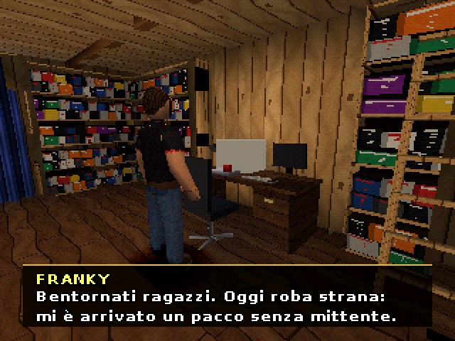
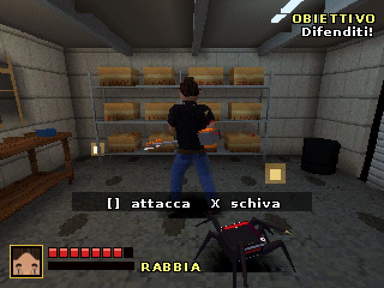

# FRC – L'Ultima Recensione

Horror-comedy per PlayStation 1 con Franky Retron. Una notte di pioggia sulle colline toscane, un pacco senza mittente e una cartuccia che non andava provata.

**Download demo (BIN/CUE):** [FRC_demo_PS1.zip](FRC_demo_PS1.zip) — apri `FRC.cue` con DuckStation, ePSXe, PCSX-Redux o Mednafen.

Contiene il Capitolo 1 "Lo Studio" e la modalità Arena (1-2 giocatori, Franky / Francesco / Erika, 7 armi).

 

Un gioco creato da Sanciopanza88.
